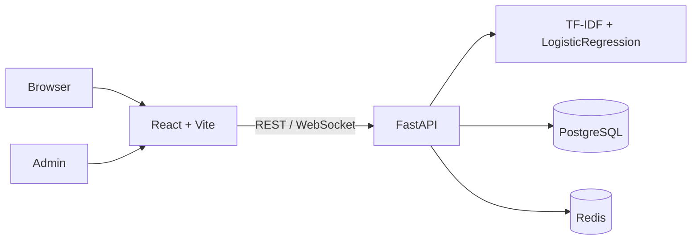

# AI Customer Support System

A full-stack support application with a FastAPI API, React client, ML-assisted message triage, ticket workflows, and administrator tools.

## Features

- Email/password registration and login, short-lived JWT access tokens, and rotating HttpOnly refresh cookies.
- Persistent conversations and ticket history backed by PostgreSQL.
- TF-IDF retrieval and logistic-regression classification, with confidence/similarity thresholds and escalation for potential fraud.
- REST chat with an authenticated WebSocket option and automatic ticket escalation.
- Admin ticket management, live replies, knowledge-base editing, retraining, and summary statistics.
- Redis-backed response caching and rate limiting.
- Docker Compose deployment, Nginx reverse proxy, optional TLS proxy, and CI checks.

## Architecture



## Run with Docker Compose

Requirements: Docker Engine and the Docker Compose plugin.

1. Copy `.env.example` to `.env`. Set a unique `JWT_SECRET` (at least 32 characters), a strong `POSTGRES_PASSWORD`, and strong first-admin credentials. For example, generate a secret with `openssl rand -hex 32`.
2. Start the services:

   ```bash
   docker compose up --build
   ```

3. Open the app at [http://localhost](http://localhost) or [http://localhost:5173](http://localhost:5173). The API is at [http://localhost:8000](http://localhost:8000), with interactive docs at [http://localhost:8000/docs](http://localhost:8000/docs).

Compose runs the database migration and seeds the first administrator before starting the API. The first admin credentials come from `FIRST_ADMIN_EMAIL` and `FIRST_ADMIN_PASSWORD`; change the example values before use. PostgreSQL, Redis, and generated model artifacts use named volumes.

### Optional HTTPS proxy

Place `fullchain.pem` and `privkey.pem` in a local `certs/` directory, then start the TLS proxy:

```bash
docker compose --profile production up --build
```

The TLS proxy listens on port 443. The development HTTP proxy and application ports remain available in this profile. Use certificates for the hostname you serve and configure `CORS_ORIGINS` to the exact browser origin.

## Run services locally

For local development without Compose, run PostgreSQL and Redis separately. Configure `DATABASE_URL`, `REDIS_URL`, and `JWT_SECRET` in `backend/.env` using `backend/.env.example` as a starting point.

```bash
cd backend
python -m venv .venv
source .venv/bin/activate
python -m pip install -r requirements.txt
alembic upgrade head
python scripts/seed.py
uvicorn app.main:app --reload
```

In another terminal:

```bash
cd frontend
npm ci
cp .env.example .env
npm run dev
```

The Vite development server proxies `/api` and `/ws` to `http://localhost:8000`. Override `VITE_API_URL` or `VITE_WS_URL` in `frontend/.env` when using a different backend host.

### GitHub Codespaces

The configured Dev Container provides Python 3.12, Node 20, and forwards ports 5173 and 8000. After the container installs the backend and frontend dependencies, start PostgreSQL and Redis, then follow the local backend and frontend commands above.

## API overview

All HTTP endpoints are under `/api`. Authenticated requests use `Authorization: Bearer <access_token>`. Login and refresh set the refresh token in an HttpOnly cookie; `/auth/refresh` also requires `X-Requested-With: fetch`.

| Method | Path | Purpose |
| --- | --- | --- |
| `POST` | `/auth/register` | Register with `name`, `email`, and `password` |
| `POST` | `/auth/login` | Sign in; returns `access_token`, `token_type`, and `user` |
| `POST` | `/auth/refresh` | Rotate refresh cookie and issue an access token |
| `POST` | `/auth/logout` | Revoke refresh token and clear its cookie |
| `GET` | `/auth/me` | Return the authenticated user |
| `POST` | `/chat` | Send a message; returns `conversation_id`, `message_id`, reply, triage fields, and optional `ticket_id` |
| `GET` | `/conversations` | List the current user's conversations |
| `GET` | `/conversations/{conversation_id}` | Load a conversation and its messages |
| `GET` | `/tickets` | List the current user's tickets |
| `GET` | `/tickets/{ticket_id}` | Load one of the current user's tickets |
| `GET` | `/admin/tickets` | List tickets; supports `status`, `category`, `priority`, and `page` filters |
| `PATCH` | `/admin/tickets/{ticket_id}` | Change ticket status |
| `POST` | `/admin/tickets/{ticket_id}/reply` | Reply to a ticket and notify the user over WebSocket |
| `GET` | `/admin/stats` | Read support dashboard statistics |
| `GET`, `POST` | `/admin/knowledge` | List or add knowledge entries |
| `PUT`, `DELETE` | `/admin/knowledge/{entry_id}` | Update or remove a knowledge entry |
| `POST` | `/admin/retrain` | Rebuild and reload the ML model |
| `GET` | `/admin/users` | List up to 100 users |
| `GET` | `/health` | Check database and Redis status |

Admin paths require an administrator account. The WebSocket endpoint is `/ws/chat` (not under `/api`): send `{"type":"auth","access_token":"..."}` as the first frame, then send `{"type":"user_message","text":"..."}` frames. Do not put access tokens in the WebSocket URL.

## Tests and model training

```bash
cd backend
ruff check .
pytest -q
python -m app.ml.train
```

```bash
cd frontend
npm run lint
npm test
npm run build
```

To run the end-to-end API/WebSocket smoke test against an already-running stack, export `FIRST_ADMIN_EMAIL` and `FIRST_ADMIN_PASSWORD`, then run `python backend/scripts/smoke_test.py`. The script creates a temporary user and exercises the chat, fraud escalation, ticket, admin, retraining, and WebSocket reply flows.

## Configuration and security

- Keep `.env` files, production credentials, and TLS private keys out of version control.
- In production, set `ENV=production`, use a random `JWT_SECRET` of at least 32 characters, set strong database/admin passwords, and use HTTPS.
- Set `CORS_ORIGINS` to a comma-separated list of exact trusted origins; wildcard origins are rejected.

| Variable | Used by | Purpose |
| --- | --- | --- |
| `DATABASE_URL` | Backend / Compose | PostgreSQL SQLAlchemy connection string |
| `REDIS_URL` | Backend / Compose | Redis connection for rate limits and caching |
| `JWT_SECRET` | Backend | Signs access and refresh tokens; must be changed for production |
| `ACCESS_TOKEN_MINUTES` | Backend | Access-token lifetime |
| `REFRESH_TOKEN_DAYS` | Backend | Refresh-token lifetime |
| `CORS_ORIGINS` | Backend | Comma-separated exact trusted origins |
| `ENV` | Backend / Compose | Runtime environment (`development`, `test`, or `production`) |
| `SIMILARITY_THRESHOLD` | Backend | Minimum retrieval similarity for a matched response |
| `CONFIDENCE_THRESHOLD` | Backend | Minimum classifier confidence for a default response |
| `FIRST_ADMIN_EMAIL`, `FIRST_ADMIN_PASSWORD` | Backend / Compose | Bootstrap the first administrator |
| `POSTGRES_DB`, `POSTGRES_USER`, `POSTGRES_PASSWORD` | Compose | Initialize the PostgreSQL container |
| `VITE_API_URL` | Frontend build | HTTP API base URL |
| `VITE_WS_URL` | Frontend build | Optional WebSocket URL |
| `VITE_USE_MOCK` | Frontend build | Enable MSW mock responses for local development |

## Cloud deployment

The backend and frontend each have a Dockerfile. For Render or Railway, deploy the backend image as a web service and the frontend image behind a TLS-enabled reverse proxy; provision managed PostgreSQL and Redis, set the environment variables above, and allow the backend to run `alembic upgrade head` before serving traffic. Configure the proxy to forward `/api` and upgraded `/ws` requests to the backend and all other paths to the frontend. On AWS, the equivalent layout can use ECR images, ECS/Fargate services, managed RDS PostgreSQL, ElastiCache Redis, and an HTTPS Application Load Balancer. Adapt network rules, secrets storage, backups, and health checks to the chosen provider.

## Repository layout

- `backend/app/` — API routes, database models, authentication, chat, and ML services.
- `backend/data/knowledge_base.csv` — initial triage and response examples.
- `backend/alembic/` — database migrations.
- `frontend/src/` — application pages, API client, state, and MSW mocks.
- `nginx/` — HTTP and optional TLS reverse-proxy configurations.
- `.github/workflows/ci.yml` — backend/frontend checks.
